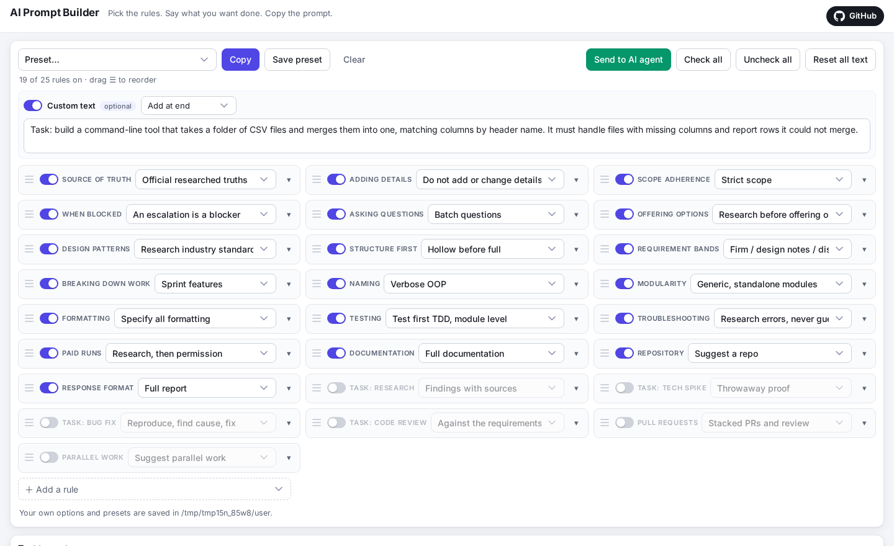
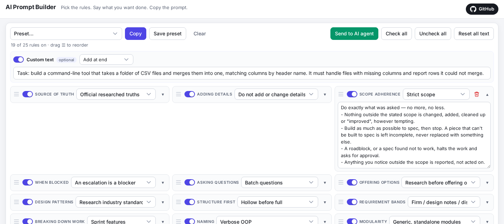
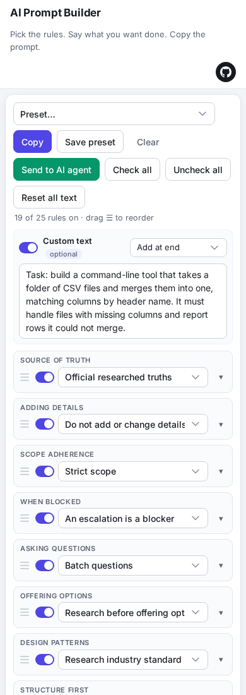

<div align="center">

# AI Prompt Builder -- Standalone Tool OR Integrated Agent Skill

**Web Tool: Build the prompt for your AI agent**

**Agent Skill: Ensure requirements collected, save profiles, leverage local web tool for editing/customizing**

[**Open the web tool →**](https://randyhaylor.github.io/ai-prompt-builder/)

Web page · command-line tool · agent skill — one set of rules, one file format

</div>



---

## What it does

Every rule is one topic — *Naming*, *Testing*, *Scope adherence*, *When blocked*,
*Paid runs*, *Response format* and more — with a few real alternatives to choose from.

- **Switch rules on and off.** Nothing is ever hidden: a rule that's off stays in its place, greyed out.
- **Choose an option** for each rule, or write your own.
- **Edit any rule's text** right where it is. Reset it, or save your edit as a new option.
- **Drag to reorder** — mouse, touch, or arrow keys.
- **Custom text** turns a general ruleset into a specific prompt: say what you actually want done, at the end or the beginning.
- **Presets** for common jobs, and your own presets saved by name.
- **Copy** the finished text, ready to paste.

## Presets

| Preset | For |
|---|---|
| **Careful developer** *(default)* | researches, plans, scaffolds, tests first, documents |
| **Quick developer** | builds fast, researches only when needed, tests what it made |
| **Careful dev manager** | plans and delegates: sprint features, parallel work, stacked PRs |
| **Research** · **Tech spike** · **Bug fix** · **PR / diff review** · **Comprehensive code review** | one kind of task, with the rules that fit it |
| **Small one-off** | a tiny, well-defined job |
| **Document writer** · **Op-Ed Writer** · **Speech writer** · **Proofreader** · **Policy reviewer** | writing work: draft a document, proofread text, review a policy for gaps and risks |

Each preset comes with example custom text showing how it becomes a real request.



<table><tr>
<td width="62%" valign="top">

### On a phone

The same tool, one column. Rules stay collapsed to a single line until you open one.

### Where your additions go

On the web tool, your own options and presets last for the session.
Saving them to your Google account is planned.

Run it through the command-line tool and they're saved as JSON files on your
computer — see below.

</td>
<td width="38%"></td>
</tr></table>

---

## For AI agents: the skill and the command-line tool

**In short:** instead of you remembering everything, the agent walks you through a checklist.
It goes rule by rule — *"Testing: none, quick check, or test-first? Docs: none, README, or
full? Research first or just build? How should it handle paid runs?"* — one question at a
time, with real options to pick from. So documentation, testing and research get asked
about every time instead of forgotten.

Or skip all that: pick a preset like *Careful developer*, and the agent only asks what you
want to change and what the actual task is. Rather click than chat? It opens the web page
for you, you flip switches, hit **Send to local AI agent**, and it gets your finished prompt back.

At the end it offers to save your answers as a preset, so next time it's one click.

The repository is also an **agent skill** that works with any harness — Claude Code,
Codex, OpenAI agents, anything that can run a command. The agent walks the user through the
rules one at a time, or opens the web page for them, and gets the finished ruleset back.

**Install:** clone this repository into your harness's skills folder (or anywhere), and
point your agent at [`SKILL.md`](SKILL.md). Python 3.9+, standard library only, any OS.

```bash
git clone https://github.com/RandyHaylor/ai-prompt-builder.git
cd ai-prompt-builder
python -m ai_prompt_builder presets
```

### The command line is the page, as commands

```bash
python -m ai_prompt_builder new mine.json --preset "Careful developer"
python -m ai_prompt_builder set mine.json testing --option simple-post-testing
python -m ai_prompt_builder set mine.json prs --off
python -m ai_prompt_builder custom-text mine.json --text "Add CSV export to the reports page."
python -m ai_prompt_builder compose mine.json            # the text to paste
python -m ai_prompt_builder save-preset mine.json "My reviews"
```

Run `python -m ai_prompt_builder --help` for every command: browsing rules and options,
reordering, editing text, adding your own options and categories, and more.

### Opening the page from an agent, with "Send to local AI agent"

```bash
python -m ai_prompt_builder serve --ruleset-file mine.json --send-to-agent-file /tmp/sent.json
python -m ai_prompt_builder wait-for-send /tmp/sent.json      # in the background
```

- `serve` prints one line of JSON with the page's address, then keeps running.
- Each server takes its own free port, so every agent session can have its own.
- The **Send to local AI agent** button is enabled only in a page started this way. On the
  public web tool it's shown but disabled.
- Clicking it saves the ruleset and its text to the send file. `wait-for-send` exits at
  that moment and prints what was sent.

### Where things are kept

| What | Where |
|---|---|
| Shipped rules and presets | [`data/`](data) — read by the page and the tool alike |
| Your options and presets | `~/.ai-prompt-builder/` — or `.ai-prompt-builder/` in your project, to share with a team |
| A ruleset | any JSON file you name — [the format is in SKILL.md](SKILL.md#file-format) |

### Good uses

Standing instructions for a deployed agent · the rules section of a handoff document · a
team's shared way of working · a one-off prompt for a specific task.

---

## Inside

| Part | Files |
|---|---|
| Rules and presets | `data/rule-categories.json`, `data/presets/*.json` |
| Web page | `index.html`, `css/`, `js/` — plain HTML, CSS and JavaScript modules, no build step |
| Command-line tool and local server | `ai_prompt_builder/` — Python standard library only |
| Tests | `tests/` — `python -m pytest tests` or `python -m unittest discover tests` |

The page reads and saves your additions through one small interface
(`js/preference-stores/`): one store for the session, one for the local server, and a
Google Drive store to come.

To run the page locally without the tool: `python -m http.server` in this folder.
